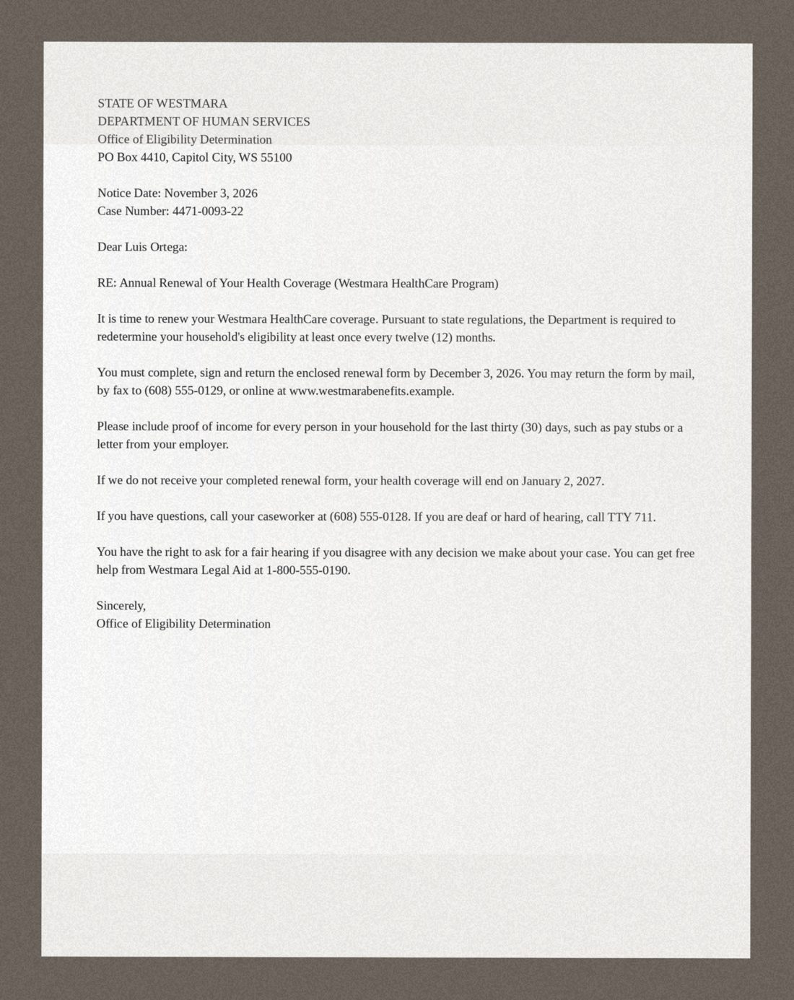
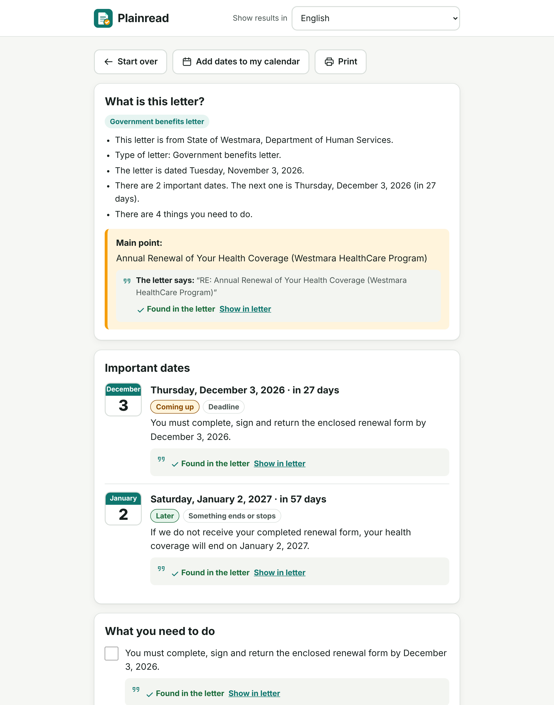
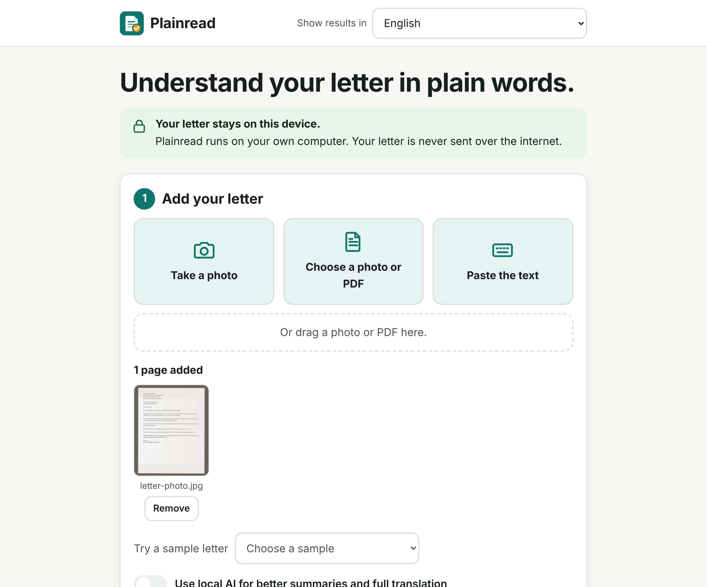
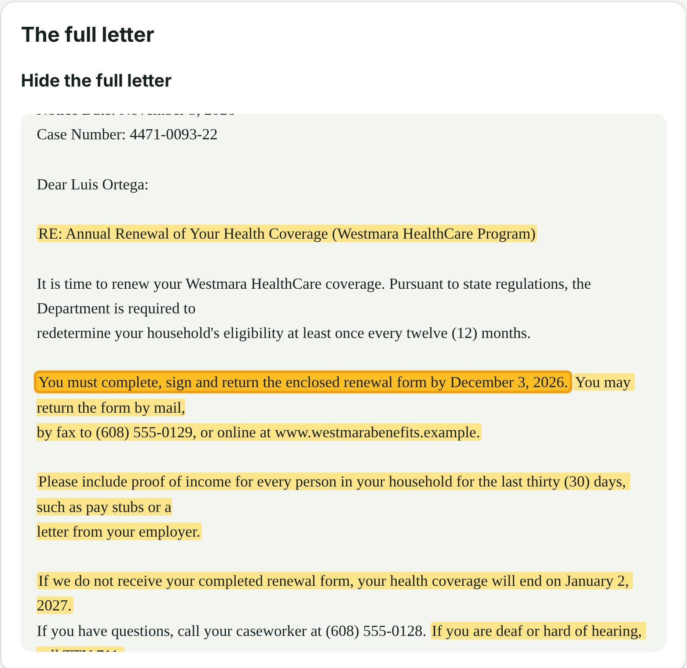
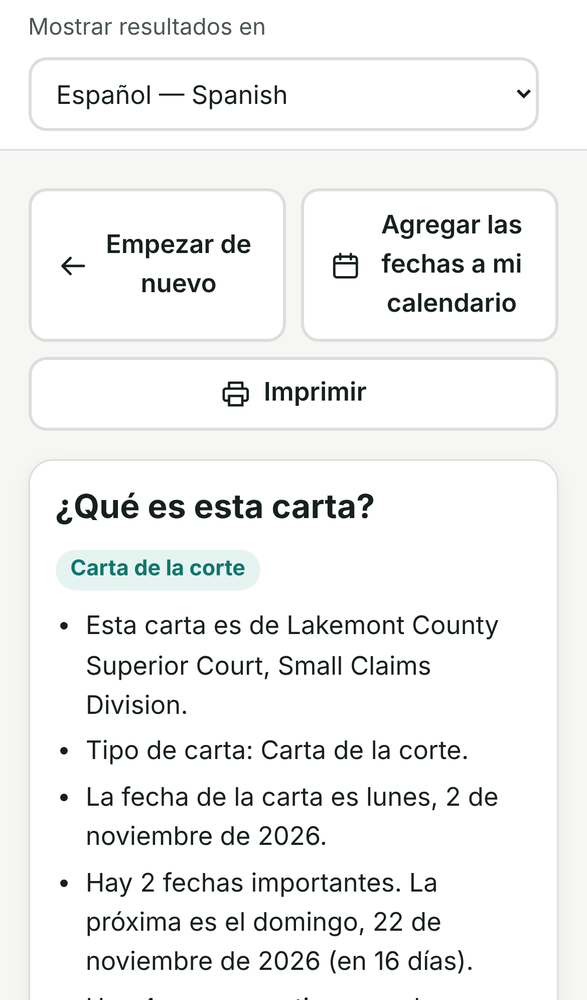
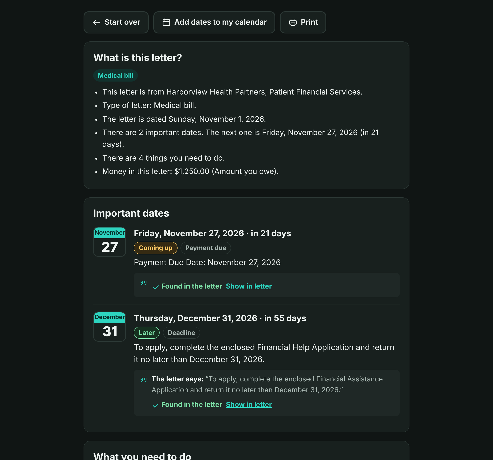
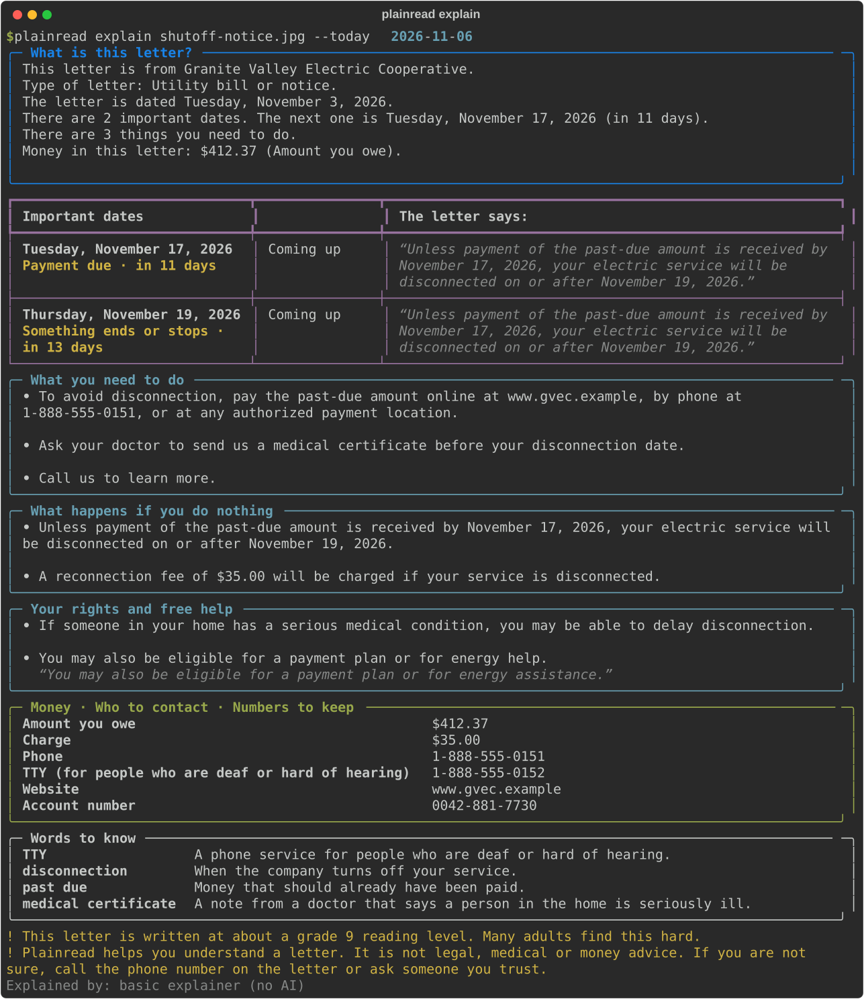
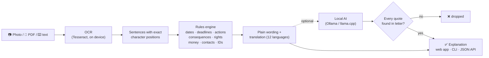

<div align="center">


# Plainread

**Understand hard letters in plain words — privately, on your own device.**

Photograph a letter from a court, hospital, insurer or benefits office. Plainread tells you
what it is, **every deadline**, **what to do next** and **what happens if you do nothing** —
in your own language, with the letter's own words as proof for every point.

[](https://github.com/lobojoel2003/Plainread/actions/workflows/ci.yml)
[](https://github.com/lobojoel2003/Plainread/releases/latest)
[](https://github.com/lobojoel2003/Plainread/actions/workflows/codeql.yml)
[](pyproject.toml)
[](LICENSE)
[](https://github.com/lobojoel2003/Plainread/pkgs/container/plainread)

[Download](#get-started) · [How it works](#how-it-works) · [Accuracy](#accuracy) · [Languages](#languages) · [Privacy](#privacy)

</div>

<p align="center">
  
  &nbsp;&nbsp;➜&nbsp;&nbsp;
  
</p>

---

## Why Plainread?

Letters from courts, hospitals, insurers and benefits offices are hard to read. People with
low literacy, or who read English as a second language, miss deadlines or lose benefits
because of it.

- **28% of US adults** scored at or below the lowest literacy level in 2023, up from 19% in
  2017 ([NCES](https://ies.ed.gov/learn/press-release/u-s-adults-score-par-international-average-literacy-skills-below-international-average-numeracy-and)).
- The US government's own guidance calls plain language "critical to helping the public to
  make sense of their obligations and benefits"
  ([Digital.gov](https://digital.gov/guides/plain-language)) — but many letters still aren't
  written that way. The 34 sample letters in this repo have a median **grade 10 reading
  level** (up to grade 14), while plain-language guidance aims for about grade 6–8.
- Existing tools either send your private letter to a cloud AI
  ([SimplifyMyText](https://fis.tu-dresden.de/portal/de/publications/simplifymytext(ef960b30-3355-4461-9ff9-007eabe4adb5).html),
  GPT-4 / Llama-3, no public code) or are hackathon demos
  ([plainletter](https://github.com/RostyslavDzhohola/plainletter)).

**Plainread fills the gap:** a free app that runs entirely on your device, so private letters
never leave it, and that backs every claim with a quote from the letter so you can trust it.

## What it does

| | |
| --- | --- |
| 📷 **Reads the letter** | Take a photo (or several pages), open a PDF, or paste the text. Photos are cleaned up (rotation, contrast) and read with Tesseract OCR. |
| 📅 **Finds every important date** | Deadlines, court dates, appointments, payment due dates, and when benefits or service end or change — with the time, how many days are left, and an urgency label. Periods such as *"within 30 days of the date of this notice"* are turned into a real date, with a note explaining how it was counted. |
| ✅ **Tells you what to do** | Each thing you must do as a short plain sentence, as a checklist. Lists in the letter ("Please bring: …") stay together. |
| ⚠️ **What happens if you do nothing** | Late fees, shut-offs, default judgments, losing coverage. |
| 🛟 **Your rights and free help** | Appeals, fair hearings, free interpreters, payment plans, financial assistance, legal aid. |
| 💵 📞 🔢 **Money, contacts and numbers** | Amounts you owe, tap-to-call phone numbers (including TTY), emails, websites, and case/claim/account numbers with copy buttons. |
| 🔎 **Proof for every point** | Every item shows *"The letter says: …"* and **Show in letter** highlights the exact words in the full text. |
| 🌍 **12 languages** | Results and the app in English, Spanish, Chinese, Vietnamese, Tagalog, Korean, Russian, Arabic, Haitian Creole, French, Portuguese and Hindi. |
| 📖 **Words to know** | Plain meanings of ~100 legal, medical, insurance and benefits terms found in the letter. |
| 🔊 📆 🖨️ **Read aloud, calendar, print** | On-device voices only; `.ics` calendar file with reminders 3 days and 1 day before; print-friendly layout. |
| 🤖 **Optional local AI** | With [Ollama](https://ollama.com) or any local OpenAI-compatible server, Plainread rewrites everything in plainer words and translates it fully. The AI never invents dates, amounts or numbers, and anything it says must quote the letter or it is removed. |

### Screenshots

| Start: add a photo, PDF or text | Show in letter: the exact words, highlighted |
| --- | --- |
|  |  |

| On a phone, in Spanish | Dark mode |
| --- | --- |
|  |  |

And in the terminal:



> All letters shown are fictional samples bundled with Plainread.

## Get started

### Option 1 — Download the app (easiest)

Get the latest file for your computer from **[Releases](https://github.com/lobojoel2003/Plainread/releases/latest)**:

| Computer | File |
| --- | --- |
| Windows | `plainread-<version>-windows-x86_64.zip` |
| Mac (Apple silicon) | `plainread-<version>-macos-arm64.zip` |
| Linux | `plainread-<version>-linux-x86_64.tar.gz` |

Unzip it and double-click **plainread**. Your browser opens at <http://127.0.0.1:8765>.
(On a Mac, right-click → **Open** the first time. On Windows, if SmartScreen appears, click
**More info → Run anyway**.)

To read **photos**, also install the free Tesseract OCR once:
[Windows](https://github.com/UB-Mannheim/tesseract/wiki) · macOS `brew install tesseract` ·
Linux `sudo apt install tesseract-ocr`. Without it you can still open PDFs or paste text.

### Option 2 — Docker (Tesseract included)

```bash
docker run --rm -p 127.0.0.1:8765:8765 ghcr.io/lobojoel2003/plainread:latest
```

With a local AI model as well:

```bash
docker compose up -d
```

```bash
docker compose exec ollama ollama pull gemma3:4b
```

### Option 3 — Python

```bash
pip install "plainread @ git+https://github.com/lobojoel2003/Plainread@v1.0.0"
```

```bash
plainread
```

Check your setup at any time with `plainread doctor`.

### Optional: local AI for plainer wording and full translation

1. Install [Ollama](https://ollama.com) and run `ollama pull gemma3:4b` (about 3 GB, once).
2. In Plainread, turn on **Use local AI**.

Any OpenAI-compatible server on your machine works too, such as llama.cpp's `llama-server`
(`PLAINREAD_AI_BACKEND=openai PLAINREAD_AI_URL=http://127.0.0.1:8080/v1`). Without AI,
Plainread still finds everything; headings, labels, dates and summaries are translated, and
the letter's own sentences are shown in English.

## How it works



1. **Read.** Photos are rotated using the camera's EXIF data, converted to grayscale,
   contrast-stretched and upscaled, then read by Tesseract. Word positions are used to keep
   table columns lined up. PDFs use their text layer, falling back to OCR for scanned pages.
2. **Split.** The text is split into sentences, list items, headings and `Label: value`
   lines, each with its exact start and end position in the letter.
3. **Extract.** A rules engine — no AI needed — finds dates in a dozen formats (including
   "the 3rd of June", "Tue., Sept. 8" and "on the 14th"), works out deadlines given as
   periods (calendar or business days), decides what each date means from the words around
   it, and finds actions, consequences, rights, amounts, phone numbers, emails, websites and
   reference numbers.
4. **Explain.** Officialese is rewritten conservatively ("pursuant to" → "under", "remit" →
   "send", "thirty (30) days" → "30 days"); summary sentences, labels and dates are
   translated; hard words get plain meanings; the letter's reading level is measured.
5. **Optional AI.** A local model rewrites each item in plainer words and in your language.
   It can add missed items only with a quote, and every quote is checked against the letter
   (allowing for spacing, quote marks and small OCR slips). Dates and numbers always come
   from the rules engine.

## Accuracy

Plainread is tested against hand-labelled **fictional** letters
([format](eval/README.md)). Every push runs these checks in CI and fails if quality drops.

| What is measured | Development set<br/>22 letters, text | Development set<br/>22 letters, photos | Held-out set<br/>12 letters, **first blind run** | Held-out set<br/>12 letters, after fixes |
| --- | ---: | ---: | ---: | ---: |
| Important dates found (F1) | 100% | 100% | 72% | 100% |
| …and labelled correctly | 98% | 89% | 83% | 80% |
| Letter's own date | 100% | 100% | 75% | 100% |
| Money amounts (F1) | 100% | 100% | 100% | 100% |
| Phone numbers (F1) | 100% | 100% | 100% | 100% |
| Emails (F1) | 100% | 100% | 100% | 100% |
| Websites (F1) | 100% | 100% | 100% | 100% |
| Case / account numbers (F1) | 100% | 94% | 91% | 100% |
| Things to do (recall) | 100% | 89% | 93% | 93% |
| Consequences (recall) | 100% | 85% | 79% | 79% |
| Rights and free help (recall) | 100% | 93% | 85% | 85% |
| Type of letter | 100% | 100% | 83% | 100% |
| Quotes found in letter | 100% | 100% | 100% | 100% |

- **Development set** (`eval/letters/`): 22 letters (court summons, eviction, jury duty,
  hospital bills, insurance denials, benefits renewals and interviews, overpayments, tax,
  utility shut-off, debt collection, immigration, school, medical prep, and more). The rules
  were developed against these letters, so treat these numbers as a regression test.
- **Photos**: each letter is rendered as a tilted, noisy, unevenly lit phone photo and read
  back with OCR (`plainread eval --ocr`).
- **Held-out set** (`eval/holdout/`): 12 different letters written independently *after*
  the engine was built. The **first blind run** is the honest estimate of how Plainread does
  on letters it has never seen. After that run, the error *types* were fixed in general ways
  (for example, "on the 14th" dates and letterhead detection) — never with letter-specific
  rules — giving the last column. A fresh held-out set will be written for the next release.
- **Quotes found in letter** is 100% by design: Plainread never shows a statement it cannot
  point to in the letter.

Run it yourself: `plainread eval`, `plainread eval --ocr`, `plainread eval --letters eval/holdout --no-fail`.

## Languages

| | | | |
| --- | --- | --- | --- |
| English | Español | 中文（简体） | Tiếng Việt |
| Tagalog | 한국어 | Русский | العربية (right-to-left) |
| Kreyòl ayisyen | Français | Português | हिन्दी |

These are the languages most often spoken at home by US residents with limited English.
Translations were written in simple, everyday words; corrections from native speakers are
very welcome.

## Privacy

- **Nothing leaves your device.** Letters are processed in memory and never written to disk,
  logged or sent anywhere. The web app loads no fonts, scripts or images from the internet
  and has a strict Content Security Policy.
- **Only this computer can connect.** The server listens on `127.0.0.1` unless you choose
  otherwise.
- **The AI must be local.** Plainread refuses to send a letter to an AI server that is not
  on this computer or your local network (override with `PLAINREAD_ALLOW_REMOTE_AI=1`).
- **Read aloud uses on-device voices only**, because some browsers' online voices send text
  to a server.
- **No accounts, no tracking, no analytics.** Only your language choice is remembered.

## Command line

```text
plainread                      start the web app and open your browser
plainread serve [--port N]     start the web app (127.0.0.1:8765 by default)
plainread explain FILE...      explain photos, PDFs or text files ('-' reads stdin)
    --lang es                  results in another language
    --ai                       use the local AI model
    --json                     machine-readable output
    --ics dates.ics            also save the dates as a calendar file
    --today 2026-03-02         pretend today is another day
    --date-order DMY           read 03/04/2026 as 3 April
plainread eval [--ocr]         score Plainread on the labelled letters
plainread doctor               check that OCR and local AI are set up
plainread languages            list languages
plainread --version            version, build number and commit
```

## API

The web app is built on a small JSON API (interactive docs at
<http://127.0.0.1:8765/api/docs>):

| Method | Path | What it does |
| --- | --- | --- |
| `POST` | `/api/explain` | Multipart form: `files` (photos/PDFs/text, several pages allowed) or `text`, plus `language`, `use_ai`, `today`. |
| `POST` | `/api/explain/text` | JSON body: `{"text": "...", "language": "es"}`. |
| `POST` | `/api/calendar` | Turn `dates` from an explanation into an `.ics` file. |
| `GET` | `/api/health` | Version, build number, OCR and AI status. |
| `GET` | `/api/languages`, `/api/i18n/{code}` | Supported languages and their text. |
| `GET` | `/api/samples`, `/api/samples/{id}` | Fictional sample letters. |

```bash
curl -s http://127.0.0.1:8765/api/explain -F files=@letter.jpg -F language=es
```

## Configuration

All settings are optional environment variables.

| Variable | Default | Meaning |
| --- | --- | --- |
| `PLAINREAD_HOST` / `PLAINREAD_PORT` | `127.0.0.1` / `8765` | Where the web app listens. |
| `PLAINREAD_AI` | `auto` | `off` hides the local AI option. |
| `PLAINREAD_AI_BACKEND` | `ollama` | `ollama` or `openai` (any OpenAI-compatible local server). |
| `PLAINREAD_OLLAMA_URL` | `http://127.0.0.1:11434` | Ollama address (also reads `OLLAMA_HOST`). |
| `PLAINREAD_AI_URL` | `http://127.0.0.1:8080/v1` | OpenAI-compatible server address. |
| `PLAINREAD_MODEL` | `gemma3:4b` | Model name. `qwen2.5:3b` and `llama3.2:3b` also work well. |
| `PLAINREAD_AI_TIMEOUT` | `300` | Seconds to wait for the model. |
| `PLAINREAD_ALLOW_REMOTE_AI` | off | Allow a non-local AI server (not recommended). |
| `PLAINREAD_OCR_LANG` | `eng` | Tesseract language(s), e.g. `eng+spa`. |
| `PLAINREAD_TESSERACT` | auto | Path to the `tesseract` program. |
| `PLAINREAD_DATE_ORDER` | `MDY` | `DMY` to read `03/04/2026` as 3 April. |
| `PLAINREAD_MAX_UPLOAD_MB` / `PLAINREAD_MAX_FILES` | `25` / `10` | Upload limits. |

## Versions, builds and releases

- **Semantic versioning** (`MAJOR.MINOR.PATCH`), with one source of truth in
  [`src/plainread/__init__.py`](src/plainread/__init__.py) and a
  [changelog](CHANGELOG.md).
- **Build numbers:** every CI build stamps the GitHub Actions run number, commit and build
  time into the package. You see them in `plainread --version`, the app footer and
  `/api/health`, e.g. `1.0.0 (build 12, commit 1a2b3c4)`.
- **Releases are tag-driven:** pushing a tag like `v1.0.1` runs the full CI, then builds the
  Python package, Windows/macOS/Linux apps and a multi-arch Docker image, and publishes a
  GitHub Release with notes from the changelog, `SHA256SUMS.txt` and signed
  [build provenance](https://docs.github.com/actions/security-for-github-actions/using-artifact-attestations)
  for every file (`gh attestation verify <file> --repo lobojoel2003/Plainread`).

**CI/CD pipeline** (`.github/workflows/`):

| Workflow | Runs on | What it does |
| --- | --- | --- |
| `ci.yml` | every push and pull request | Ruff lint + format, strict mypy, JavaScript syntax; tests on Python 3.10–3.14 (Linux) plus Windows and macOS; quality gates on the sample letters (text and photo); held-out report; browser tests with Playwright; wheel build + smoke test; Docker build + smoke test |
| `release.yml` | tags `v*.*.*` | Verify tag ⇄ version ⇄ changelog → full CI → package, apps, Docker image → GitHub Release with checksums and attestations (optional PyPI publish) |
| `codeql.yml` | push, pull request, weekly | Security analysis of Python, JavaScript and workflows |
| Dependabot | weekly | Updates for Python packages, Actions and the Docker base image |

## Development

```bash
git clone https://github.com/lobojoel2003/Plainread.git && cd Plainread
pip install -e ".[dev]"
pytest && ruff check src tests scripts && mypy && plainread eval
```

See [CONTRIBUTING.md](CONTRIBUTING.md) for the code layout, rules for changes and the release
process, and [SECURITY.md](SECURITY.md) to report a problem privately.

## Limitations

- Plainread helps you understand a letter. **It is not legal, medical or financial advice.**
  If you are not sure, call the number on the letter or ask someone you trust.
- It is built for US-style English letters. Other layouts and languages of the *letter
  itself* may work less well (results can be shown in 12 languages).
- Without the local AI, the letter's own sentences are shown in English (lightly
  simplified); labels, dates and summaries are translated.
- Photo quality matters: a flat, well-lit photo of the whole page works best. Plainread
  warns you when parts were hard to read.
- Business-day deadlines skip weekends but not public holidays.

## License

[Apache License 2.0](LICENSE). Copyright © 2026 Joel Stain Lobo.
